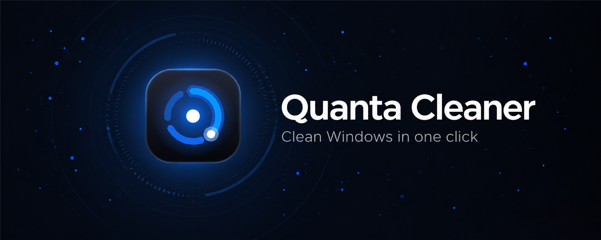
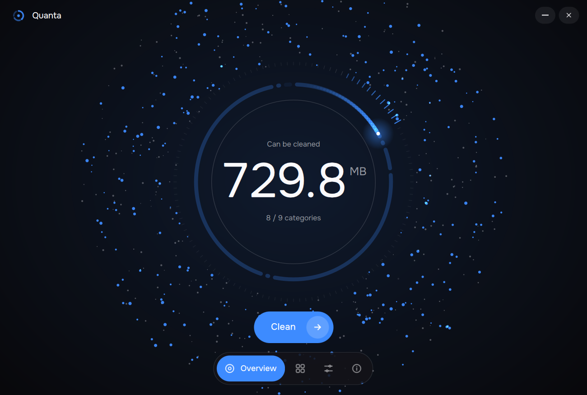
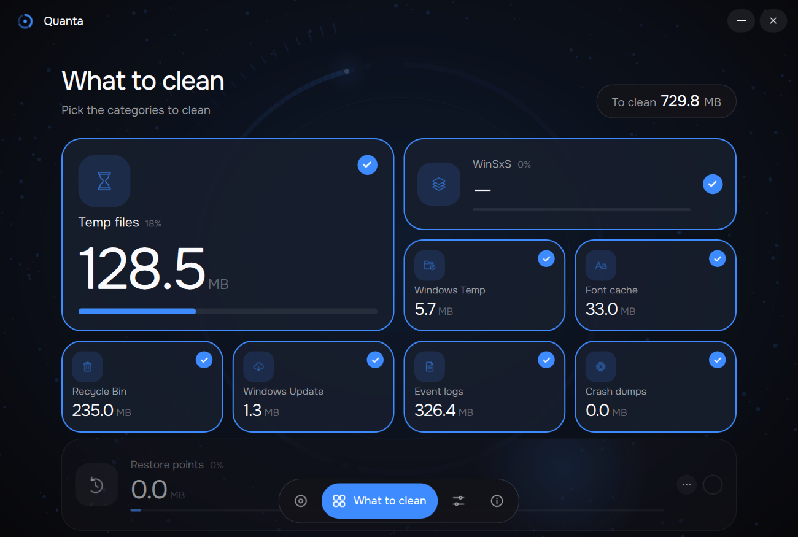
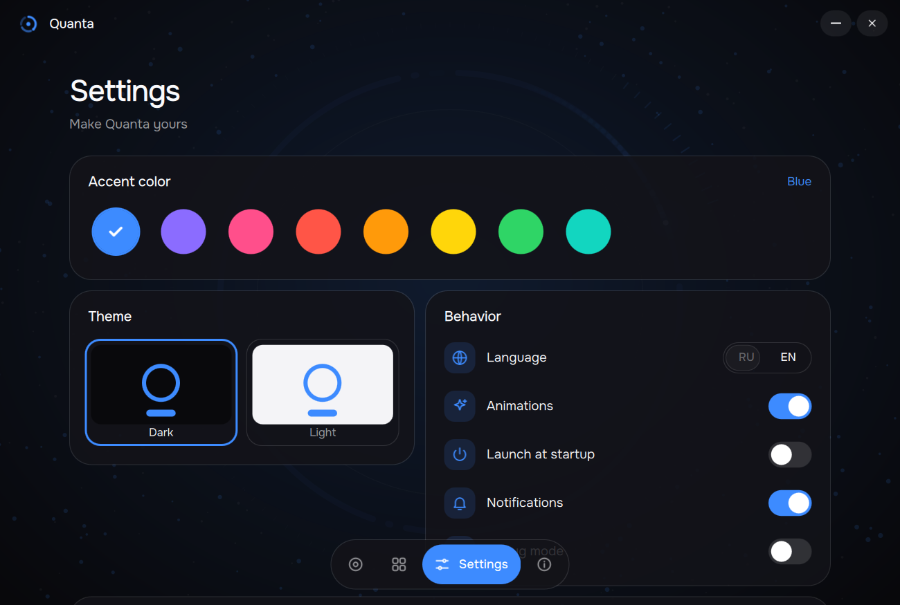
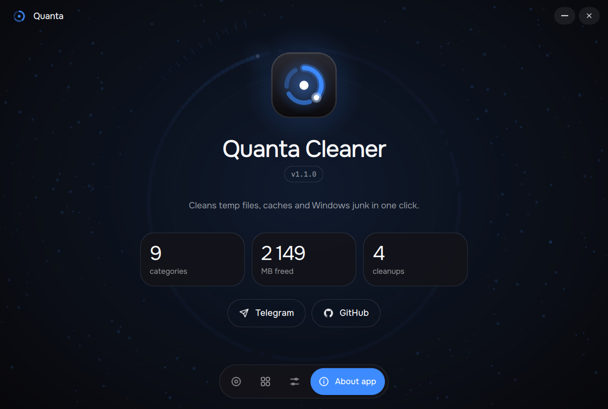

<a id="readme"></a>
<div align="center">




</div>

# Quanta Cleaner

> **Quanta Cleaner** is a fast and lightweight open-source disk cleaner for Windows with a clean, modern interface.

It finds temporary files, caches, logs and other system junk, shows how much space each category takes, and frees it in one click.

## About The Project

**Quanta Cleaner** was made to be a simple alternative to heavy all-in-one system tools.

No ads, no bundled software, no background services. You open it, see what takes up space, choose what to remove and get your disk back.

The project is useful for:

- freeing disk space on Windows 10 and 11;
- cleaning temp files and caches left by the system and apps;
- removing old update files, crash dumps and event logs;
- keeping the system tidy without installing anything.

## Key Features

- **Category Ring**  
  Every junk category is shown as a segment of one ring, so you instantly see what takes the most space.

- **Nine Cleaning Categories**  
  User temp files, Windows temp, WinSxS component store, Windows Update cache, font cache, Recycle Bin, event logs, crash dumps and restore points.

- **Choose What Goes**  
  Turn any category on or off and look inside before cleaning. Nothing is deleted without your confirmation.

- **Cleaning Log**  
  Every cleaning run is written to a log you can open right in the app.

- **Personalization**  
  Light and dark themes and eight accent colors.

- **Localization**  
  English and Russian.

- **Portable**  
  No installer. Unpack the archive and run.

## UI



| What to clean | Settings |
|---|---|
|  |  |



## Built With

- **C++17** for scanning and cleaning logic
- **Qt 6** as the application framework
- **Qt Quick / QML** for the user interface
- **CMake** for project configuration and build

## How To Start

1. Go to the [**Releases**](https://github.com/iUnreallx/Quanta-Cleaner/releases) section.
2. Download the latest archive for Windows.
3. Unpack it and run `appQuantaCleaner.exe`.

> Some categories (WinSxS, Windows Update cache, restore points) need administrator rights. Run the app as administrator to clean them.

## Build From Source

To build the project, you need:

- Qt 6.5 or newer;
- CMake 3.16 or newer;
- a C++17 compiler (MinGW or MSVC).

### 1. Clone the repository

```sh
git clone https://github.com/iUnreallx/Quanta-Cleaner.git
cd Quanta-Cleaner
```

### 2. Build with CMake

```sh
cmake -B build -DCMAKE_BUILD_TYPE=Release
cmake --build build
```

### 3. Run the application

```sh
build/appQuantaCleaner.exe
```

## Repository Structure

```text
Quanta-Cleaner/
├── Qml/                  # QML interface
│   ├── Main.qml          # window, theme, strings, navigation
│   ├── MainPage.qml      # category ring and cleaning flow
│   ├── ParametersPage.qml
│   ├── SettingsPage.qml
│   ├── AboutAppPage.qml
│   ├── *.qml             # reusable components
│   └── assets/           # fonts, icons, app icon
├── Src/
│   ├── Header/           # cleaner interfaces
│   ├── Source/           # cleaners for each category
│   └── logs/             # cleaning log helper
├── localization/         # EN / RU translations
├── screenshots/
├── main.cpp
└── CMakeLists.txt
```

## Contributing ❤️

Contributions are welcome.

If you want to improve Quanta Cleaner:

1. Fork the repository.
2. Create a new branch.

```sh
git checkout -b feature/my-amazing-feature
```

3. Commit your changes.

```sh
git commit -m "Add my-amazing-feature"
```

4. Push the branch.

```sh
git push origin feature/my-amazing-feature
```

5. Open a Pull Request.

## License

The project is distributed under the MIT license. See the [LICENSE](LICENSE) file for details.

## Contact

GitHub: [@iUnreallx](https://github.com/iUnreallx)

Project Link: [https://github.com/iUnreallx/Quanta-Cleaner](https://github.com/iUnreallx/Quanta-Cleaner)
<p align="right">(<a href="#readme">back to top</a>)</p>
